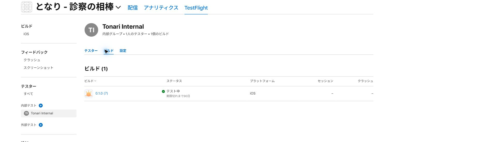

# となり iOSのインストール

**2026/10/26、0.1.0 (7)をTestFlightへ配布しました。**
本人だけの内部テストグループで「テスト中」です。
ハッカソン提出済みのTonari本体のmainと審査用公開版を保持し、iOS開発は別ブランチで行っています。

## iPhoneで入れる

1. iPhoneでTestFlightを開きます。未導入ならApp StoreからTestFlightを入れます。
2. 「となり - 診察の相棒」の **0.1.0 (7)** をインストールします。
3. 一覧に出なければ、Appleから届く招待メールの「TestFlightで表示」をiPhoneで開き、招待を受け取ります。
4. アプリを開き、既存のメールとパスワードでログインします。

受け取りには、招待されたApple Accountを使います。
TestFlightのビルドは90日間有効で、期限後も使う場合は新しいビルドへの更新が必要です。

## アプリと検証

SwiftUIとWKWebViewで現在のクラウド版を使います。
インストール後はPCの起動やUSB接続が不要で、インターネット接続が必要です。
メール認証とサーバーの家族の記録を利用できます。
Safariの端末内録音は自動移行されません。
録音は画面を開いたまま使い、共有画面からファイルに保存できます。

- iOS 17以降、バージョン0.1.0/build 7。
- [Xcode 26.3の配布ビルド](https://github.com/mugi0227/tonari-ios/actions/runs/40321246531)が成功。署名・App ID・版・ARM64・配布プロファイル・ReleaseでのDebug機能無効化を照合しました。
- Appleの処理状態VALID、内部配布IN_BETA_TESTING、アップロード検査の警告・エラー0件を確認しました。内部グループは本人1名で、公開招待リンクはありません。
- [Xcode 16.4 / iOS 18.5の検査](https://github.com/mugi0227/tonari-ios/actions/runs/39708829012)は全8件が成功。URL制限、保存名、メモと録音データの再起動後の保持、確認ダイアログ、録音の共有、通信失敗と再接続を検証しました。
- 縦横の画像を目視確認しました。実iPhoneへのインストール、ログイン・マイク・写真・現在地・長時間録音は未確認です。

[起動画面](screenshots/landing.png) / [横向きの起動](screenshots/landing-landscape.png) / [録音の共有](screenshots/recording-export.png) / [横向きの再接続](screenshots/offline-landscape.png)

画面はログイン前または架空のテスト用データです。
本番へのログイン、ゲスト作成、AI利用、既存記録の変更は行っていません。

## 最初に確認すること

最初は架空のデータを使い、ログイン、家族の予定と記録、診察準備、らむ、短い録音の開始・停止・再生、写真添付を確認します。
「録音を端末に書き出す」からiOSの共有画面を開き、「ファイルに保存」も試せます。
録音中は画面を開いたまま使います。アプリを閉じると録音を停止します。
同じ登録アカウントのサーバー上の記録は利用できます。
ゲストを選ぶと、新しい架空の家庭を作成します。
App Storeの一般公開と外部ベータ審査には提出していません。

この公開リポジトリは、本人の承認を受けた新規のiOS外枠、検証、ビルド処理とその説明だけです。
Tonari本体の非公開Web/APIソースや認証情報は含みません。
